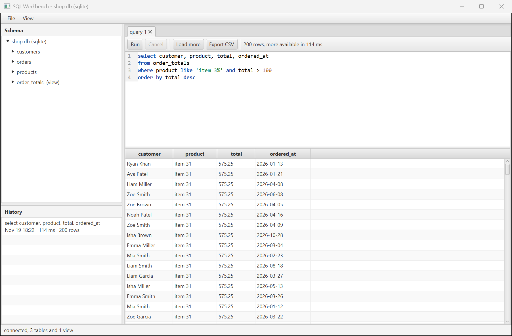

# sqlite-duckdb-sql-workbench

A desktop SQL workbench for SQLite and DuckDB database files. I wrote it in Java 21 with JavaFX and Maven, and built it in NetBeans.



## What it does

- Opens a SQLite file (.db, .sqlite) or a DuckDB file (.duckdb, .ddb) and shows its tables, views and columns in a tree. Double clicking a table previews it.
- The SQL editor has syntax highlighting and line numbers, and each query gets its own tab. Ctrl+Enter runs the whole editor, or only the selected text.
- Queries run on a background thread, so the window stays responsive, and Cancel stops a query that is still running.
- Results come back 200 rows at a time. Load more fetches the next page, and the grid stops at a row cap of 200,000 rows so a huge table cannot use up all the memory.
- Every statement goes into a history list with its time and row count. The history is kept in a file, so it is still there after a restart. Double clicking an entry puts the SQL back in the editor.
- Export CSV saves the results to a file. For read only queries it runs the query again and streams every row to disk, so the export is not limited by the row cap.
- A script with many statements runs in order. The splitter skips semicolons inside strings, quoted names and comments.

## How it works

The code is split into two packages. `core` has no JavaFX in it at all. It splits scripts into statements, runs them over JDBC, pages through the results, formats values, writes CSV, reads the schema and keeps the history. `ui` is the JavaFX side, with the main window and one `QueryTab` class per editor tab.

All database work goes through one worker thread. The JavaFX thread never waits on the database, and two tabs never use the connection at the same time. A result keeps its JDBC statement open while you page through it, so Cancel also works while a page is loading, not only during the first run.

Neither driver stops a running query through the standard JDBC query timeout. I found this when I tested it, so the timeout setting is a timer that cancels the statement instead.

The editor is a RichTextFX CodeArea. The colors come from a small SQL tokenizer in `core` that finds keywords, strings, numbers and comments.

## Running it

You need JDK 21 or newer and Maven.

```
mvn javafx:run
```

In NetBeans, use File, Open Project, pick this folder and press Run. NetBeans comes with its own Maven, so nothing else has to be installed.

Inside the app, File, Open database opens an existing file and File, New database creates an empty one.

## Settings

`workbench.properties` in the project folder holds the settings. Each value is checked when the app starts, and a bad value fails with a message that names the key.

| Key | Default | Meaning |
|---|---|---|
| page.size | 200 | rows fetched per page |
| result.max.rows | 200000 | row cap for the results grid |
| history.limit | 200 | how many history entries are shown |
| query.timeout.seconds | 0 | stops a statement that runs longer than this, 0 means no limit |
| history.file | .sqlworkbench/history.tsv in your home folder | where the history is saved |

## Tests

```
mvn verify
```

There are 47 JUnit tests. The pure parts (splitting, the tokenizer, paging, CSV, history and settings) are tested on their own. The database tests use a real temporary SQLite file. One of them starts a long recursive query on another thread and cancels it, and another checks that the timeout stops the same query after one second.

## Benchmark

```
mvn compile exec:exec@bench
```

This builds a 2,000,000 row orders table in both SQLite and DuckDB and times what the app does with it. First page means the time from sending a query to having its first 200 rows. Each query timing is the median of 5 runs after one warm up run.

These numbers are from my laptop (Windows 11, 12 cores, Java 23, 2 GB heap), plugged in. On battery the same run was up to 4 times slower.

| Step | SQLite | DuckDB |
|---|---|---|
| Build the 2,000,000 row table | 2.25 s | 1.35 s |
| First page of select * | 1.8 ms | 39.1 ms |
| First page of order by amount desc | 1063.5 ms | 238.0 ms |
| First page of group by region | 941.9 ms | 11.5 ms |
| Export all rows to CSV (86 MB) | 4.21 s, 475,309 rows/s | 3.29 s, 608,750 rows/s |
| Cancel a running query | 0.3 ms | 0.6 ms |

The results grid held 63.1 MB of heap at the 200,000 row cap. Loading all 2,000,000 rows took 622.6 MB.

What I took from this:

- SQLite hands back the first page of a plain select in under 2 ms because it streams rows as it reads them. DuckDB is slower to start on a plain select, but once the query has to sort it is about 4.5 times faster, and on the group by it is about 80 times faster.
- Cancel stopped a long query in under a millisecond on both engines.
- The row cap keeps the grid at about a tenth of the memory it would need for the whole table.

## Project layout

```
src/main/java/com/sqlworkbench/core    JDBC, paging, CSV, history, schema and settings
src/main/java/com/sqlworkbench/ui      JavaFX window and query tabs
src/main/java/com/sqlworkbench/bench   the benchmark
src/test/java/com/sqlworkbench/core    JUnit tests
```
